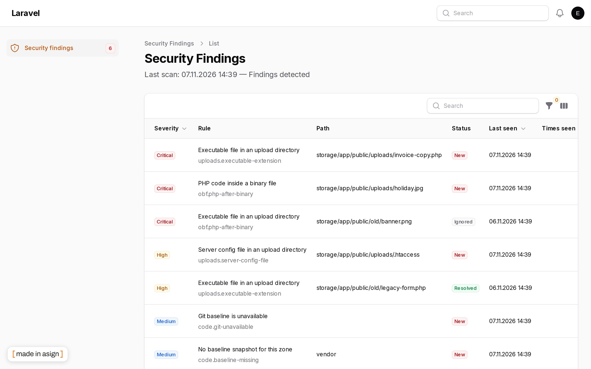
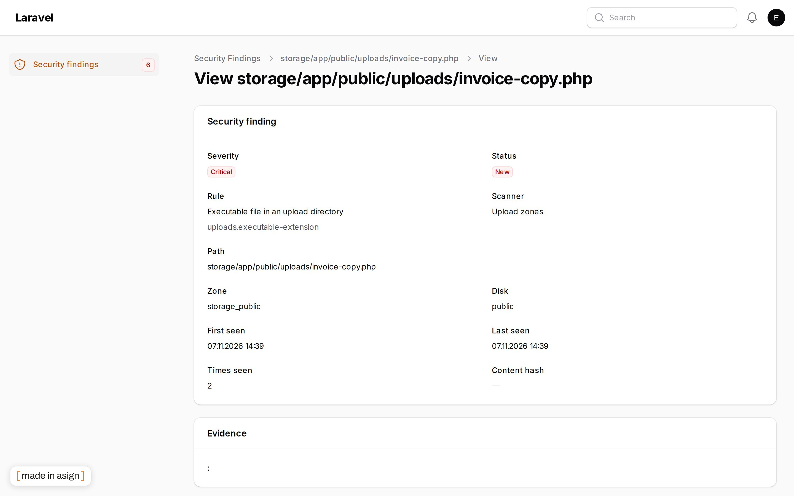
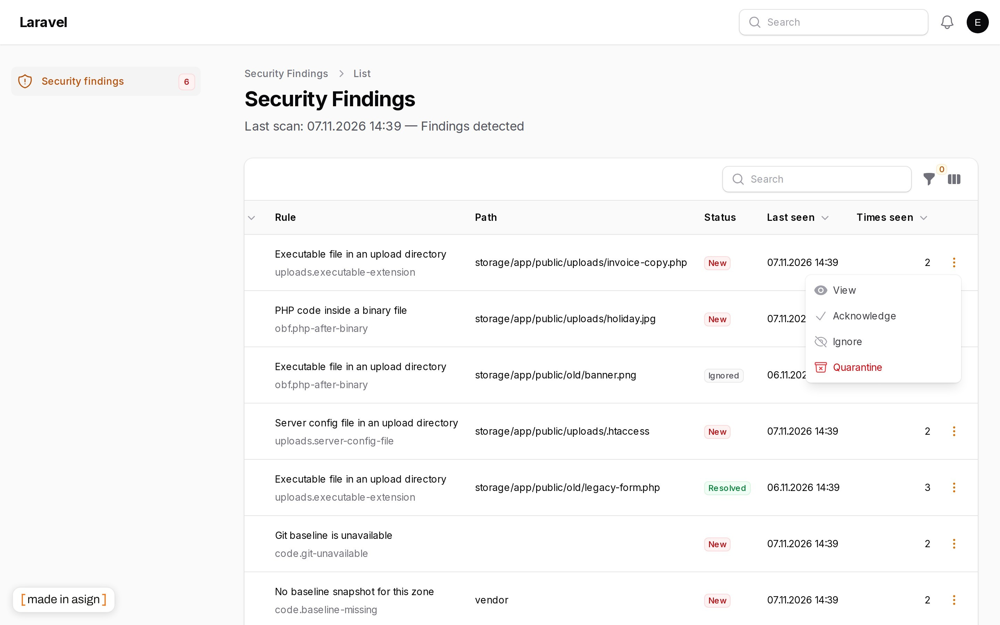

# Filament Security Scanner

[](https://stand-with-ukraine.pp.ua)
[](https://github.com/asignua/filament-security-scanner/actions/workflows/tests.yml)

A file-system intrusion **detector** for Laravel apps with a Filament 5 panel. It looks for traces of files that were
already added, changed or swapped: executable code in upload folders, web shells hidden inside images, files that
differ from git or from a hash snapshot of `vendor/`, obfuscated PHP, risky runtime settings. Findings go to a panel
resource, e-mail and Telegram, and suspicious files from upload folders can be moved to quarantine and restored.

**This is detection, not protection.** It does not block a request, does not stop an upload, does not patch anything.
It tells you, after the fact, that something is wrong. Prevention is the job of your web server and your deploy
process (see [Harden the web server](#harden-the-web-server)). A clean list means "nothing found by these rules in the
last run", not "the site is safe" - which is why the findings page always shows when the scanner last ran.

## Screenshots







## Requirements

- PHP 8.3+
- Laravel 12 or 13
- Filament 5

`spatie/laravel-medialibrary` is optional: when installed, a file is checked the moment it is added to the library.

## Installation

```bash
composer require asignua/filament-security-scanner
php artisan migrate
```

Register the plugin on your panel:

```php
use Asignua\FilamentSecurityScanner\SecurityScannerPlugin;

$panel->plugin(
    SecurityScannerPlugin::make()
        ->navigationGroup(fn (): string => __('System')) // a closure if the group is translatable
        ->navigationSort(10),
);
```

### First step: define the gates

**Nobody can see or act on findings until you define the gates.** With no gate defined, `view`, `quarantine`, `triage`
and `restore` all deny, for every user, and the resource does not appear in the navigation. `triage` (acknowledge /
ignore) falls back to whatever `quarantine` says when it has no definition of its own.

```php
// AppServiceProvider::boot()
use Asignua\FilamentSecurityScanner\SecurityScanner;
use Illuminate\Support\Facades\Gate;

Gate::define('security-scanner.view', fn ($user): bool => $user->isAdmin());
Gate::define('security-scanner.quarantine', fn ($user): bool => $user->isAdmin());
Gate::define('security-scanner.restore', fn ($user): bool => $user->isSuperAdmin());
// optional - without it, `triage` follows `quarantine`
Gate::define('security-scanner.triage', fn ($user): bool => $user->isAdmin());

// who receives the in-panel (database) notification
SecurityScanner::notifyUsersUsing(fn () => User::query()->where('is_admin', true)->get());
```

| Ability | Allows | If undefined |
|---|---|---|
| `security-scanner.view` | opening the findings resource | denied |
| `security-scanner.quarantine` | moving a file out of an upload folder | denied |
| `security-scanner.triage` | "Acknowledge" and "Ignore" (both silence alerts; ignore does so for good) | same as `quarantine` |
| `security-scanner.restore` | putting a quarantined file back (more dangerous than quarantining it, so gate it more tightly) | denied |

Gates are evaluated at call time, so a `Gate::define` in your own service provider wins regardless of boot order.
Quarantine is available for upload zones only; it can never move `.env` or application code.

### Deploy step: take the vendor baseline

`vendor/` is git-ignored, so its integrity is held by a hash snapshot. Take it on every deploy, straight after
`composer install`, and **not** from the scheduler (a snapshot taken on a schedule would bake in a swap that happened
before it):

```bash
php artisan security:baseline --zone=vendor
```

Until the first snapshot exists the scanner reports "no baseline snapshot for this zone".

The same command records the git `HEAD` of the deploy. A commit makes `git status` clean again, so a `HEAD` that differs
from the recorded one is reported as `code.git-head-moved` until the baseline is taken again: **the deploy must run
`security:baseline`**, otherwise every commit on the server raises that finding. While no `HEAD` was ever recorded the scanner
raises `code.head-unrecorded` instead (silence there would hide every commit made on the server). The `HEAD` SHA is part
of both findings' fingerprint, so ignoring one does not mask a later move.

### Schedule

The package registers its own schedule; do not add it again. You only need the Laravel scheduler running
(`php artisan schedule:run` every minute).

| Command | When |
|---|---|
| `security:scan --trigger=schedule --fail-on=none` | 04:40, without overlapping, synchronous |
| `security:prune` | 05:00 |
| `security:notify` | hourly at :15 (sends throttled notifications that are due) |

Turn it off with `SECURITY_SCANNER_SCHEDULE=false`; the times live in `config('security-scanner.schedule')`. A manual
"scan now" button in your own UI should dispatch `Jobs\SecurityScanJob` (it needs a queue worker).

## What it checks

Four scanners, driven by rules that are plain data (`resources/heuristics/heuristics.php`):

- **Upload zones** - executable files, server config files (`.htaccess`, `.user.ini`), symlinks and PHP hidden inside
  binary files (polyglots: an image that also contains PHP) in folders the app writes to.
- **Code integrity** - tracked files that differ from the git commit, untracked files in the repository, files in the
  web root that are not expected, PHP files that a nested `.gitignore` hides from `git status` in `app`, `bootstrap`
  (not `bootstrap/cache`), `config`, `database` and `routes` (`security-scanner.git.ignored_php_paths`), tracked files
  marked `assume-unchanged` / `skip-worktree`, and a hash comparison of `vendor/` against the deploy-time snapshot.
- **Obfuscation** - decoded payloads passed to `eval`, `__halt_compiler` tricks, function names built from
  concatenation, code included from temporary streams.
- **Environment hygiene** - debug mode in production, missing app key, `.env` in the web root, dangerous PHP settings,
  world-writable files.

The file read is gated by `max(mtime, ctime)`, so a nightly run does not re-read the whole disk. A run that did not see
a file never closes its finding ("not seen" is not "gone"), and a scanner that could not complete (for example git
timed out) never closes its findings either.

### Zones

```php
// config/security-scanner.php (publish with --tag=security-scanner-config)
'zones' => [
    'webroot'        => ['root' => 'public',      'kind' => 'webroot'],
    'storage_public' => ['disk' => 'public',      'kind' => 'upload:web'],      // reachable through public/storage
    'storage_app'    => ['root' => 'storage/app', 'kind' => 'upload:private'],
    'vendor'         => ['root' => 'vendor',      'kind' => 'vendor'],
],
```

Zones may nest; the more specific zone takes its folder out of the broader one's walk, so no file is visited twice.
`mergeConfigFrom()` merges only the top level: a published `zones` or `allowlist` replaces the whole list. To add one
zone from code: `config(['security-scanner.zones.media' => ['disk' => 'media', 'kind' => 'upload:private']])`. After
adding a zone run `php artisan security:scan --reread` once, because the read gate is per scanner and would otherwise
treat the new zone's old files as already checked.

The vendor integrity check does not flag this plugin's own files: the snapshot is taken after `composer install`, the
plugin's sample files are export-ignored from the dist archive and allow-listed under
`vendor/asignua/filament-security-scanner/tests/fixtures/**`, and a test scans a copy of the plugin installed in
`vendor/` with its own rules and expects no finding.

## Alerts

Three independent channels, each with its own minimum severity, throttling and "already sent" stamp:

| Channel | Setup | Default threshold |
|---|---|---|
| Panel (database notification) | `SecurityScanner::notifyUsersUsing(...)` + `->databaseNotifications()` on the panel | low |
| E-mail | `SECURITY_SCANNER_NOTIFY_MAIL=ops@example.com` | high |
| Telegram | `SECURITY_SCANNER_TELEGRAM_BOT_TOKEN`, `SECURITY_SCANNER_TELEGRAM_CHAT_ID` | high |

The panel channel needs Laravel's `notifications` table. If the host has none yet, run `php artisan make:notifications-table`
and `php artisan migrate`, and enable `->databaseNotifications()` on the panel; without both, panel alerts go nowhere.

Throttling is `SECURITY_SCANNER_NOTIFY_THROTTLE` minutes (default 60); thresholds are
`SECURITY_SCANNER_NOTIFY_MIN_PANEL|MAIL|TELEGRAM`. The first run is mailed as an "inventory", not as an alarm. A custom
mail view can be set in `security-scanner.mail.view`; it receives `$findings`, `$newCount`, `$totalCount`, `$panelUrl`,
`$isFirstRun`, `$siteName`. File names are written by the attacker: in a custom markdown view pass every cell through
`SecurityPresenter::markdownText()`.

## Quarantine

A manual quarantine moves the file to `storage/app/private/quarantine`, makes it non-executable and records who did it.
Nothing is ever deleted. Restore puts the file back only if the original path is free. Automatic quarantine is **off**
by default (`SECURITY_SCANNER_QUARANTINE_AUTO=true`), limited to `upload:web` zones, never happens on the first run, and
never on a regex-only match.

## Commands

| Command | Purpose |
|---|---|
| `security:scan [--path=*] [--fail-on=high] [--budget=] [--trigger=] [--reread]` | full pass, or only the given paths; non-zero exit when open findings reach the threshold (`none` = never) |
| `security:baseline [--zone=*] [--keep=2]` | hash snapshot of `vendor` zones - a deploy step |
| `security:rules [--validate] [--against=<dir>] [--list]` | validate the rule registry; `--against` runs it over `clean/` and `malicious/` sample folders |
| `security:prune [--days=]` | rotate runs and closed findings |
| `security:notify` | send throttled notifications that are due |

### Your own rules

Rules live in `resources/heuristics/heuristics.php`. A host overrides or adds rules in
`config/security-scanner-heuristics.php` (same format; the later file wins per rule `id`; an entry with the same `id`
and `enabled => false` switches a package rule off). Every rule is compiled when the file loads, not on the first file
at 04:40, and a rule that is not valid is reported as a finding instead of silently disabling the scan. Before adding a
rule, run it over a folder of known-clean files and a folder of known-bad samples with
`php artisan security:rules --against=<dir>` (the folder needs `clean/` and `malicious/` subfolders; sample files use
the `.fixture` extension so they are inert). A rule that fires on clean files teaches people to ignore the page.

## Harden the web server

The scanner finds files after they are on the disk. What actually stops an uploaded file from running is the web
server. With nginx, never hand a path under the `public/storage` symlink to PHP:

```nginx
location ^~ /storage/ { try_files $uri =404; }
```

Also keep PHP-FPM from writing to your code, and do not treat this package as a substitute for any of that.

## Configuration

Everything is in `config/security-scanner.php` and the `SECURITY_SCANNER_*` environment variables (enabled, table prefix,
retention, zones, allowlists, quarantine, upload check, notifications, Telegram, schedule). Tables are
`security_scans`, `security_findings` and `security_baseline`, with an optional `SECURITY_SCANNER_TABLE_PREFIX`.
`SecurityScanner::validateConfig()` returns a list of configuration problems you can call from your own health check.

## How it differs from other packages

Compared with the READMEs of `mkwebdesign/filament-watchdog-v5` (hash baseline, signatures fetched from GitHub, e-mail
alerts, lockdown, activity log) and `johnrivera7/filament-antivirus` (ClamAV upload scanning), as read on 2026-11-07.
They have different goals; the facts about this package:

- It compares tracked files with **git** and `vendor/` with a deploy-time **hash snapshot**.
- It looks for **polyglots** - valid image files that also carry PHP - in upload folders.
- Rules are data you can extend or switch off per application, with a `security:rules` gate that runs them over samples.
- Notifications are **per channel** (panel, e-mail, Telegram), each with its own threshold, throttle and stamp.
- It never downloads signatures from the network, and it has no lockdown mode and no activity log.

## Limits

What the scanner deliberately does not cover:

- `bootstrap/cache/*.php` (compiled caches) and `storage/framework/views` (compiled Blade) are allowlisted: they change on
  every request and every deploy. A shell written there is **not** reported. Keep those directories non-writable by anything
  but the application and rebuild them on deploy (`php artisan optimize:clear` / `optimize`).
- `public/storage` is trusted only while it is a symlink to the public storage directory (`filesystems.disks.public.root`);
  any other target is reported as `hygiene.foreign-storage-link`.
- Filters of the git config are switched off while the scanner runs git, except exact git-lfs commands (those too once an
  `alias.lfs` or another command-running key is present); anything else, `alias.lfs` and the partial-clone keys
  (`remote.*.uploadpack`, `remote.*.promisor`, `extensions.partialClone`) are reported as `code.git-executable-config`.
  Git runs with overrides passed through `GIT_CONFIG_*`, `--no-lazy-fetch`, `--no-replace-objects`,
  `--ignore-submodules=all` (gitlinks are listed once, not compared) and strict stat settings; every inherited `GIT_*`
  variable is dropped.
- **The git comparison is only as trustworthy as `.git`.** Someone who can write to `.git` can make git say anything
  (replace refs, rewrite the index, weaken the stat checks), and the scanner does not try to detect each such trick. It
  hardens how it calls git and raises one honest signal, `code.git-dir-writable`, when the PHP user can write to `.git`
  (not in `local` and `testing`, where that is normal). Keep `.git` owned by the deploy user and read-only for the PHP
  user, or switch git off and rely on the hash baselines.
- The scanner is detection, not protection: it sees what the web user can read, runs as that user, and a root-level attacker
  can switch it off.

## Gotchas

- A finding's title is a translation **key** resolved when it is shown, so switching language changes old findings too.
- Read the config at call time in your own code: host providers boot after package ones.
- Scanning a bind-mounted Docker volume (macOS/Windows) is many times slower than on Linux.
- An empty list can mean "all clear" or "the scanner is dead"; look at the last-scan line under the page title.

## Upgrading from `asign/eegnith-security-scanner`

The two packages share tables, config, env, commands and gate names, so they cannot be installed together (this package
`conflict`s with the old one). Switching is a code change only; stored findings, quarantine and settings stay valid.

1. Define all four gates **before** updating: undefined gates now deny (the old package allowed every panel user).
2. Let queued scanner jobs finish (they carry the old class names), then `composer remove asign/eegnith-security-scanner`
   and `composer require asignua/filament-security-scanner`.
3. Change the plugin import to `Asignua\FilamentSecurityScanner\SecurityScannerPlugin`.
4. Run `php artisan migrate` (idempotent) and, as part of your deploy, `php artisan security:baseline --zone=vendor`
   once: the vendor path changed, so old `vendor` snapshot entries close as gone and the new ones are not findings.

Open "heuristics registry rejected a rule" findings are the only ones that may reappear as new, because their identity
includes the (now English) message text.

## Translations

The interface ships in English, Ukrainian, German, Spanish, French, Italian, Dutch, Polish, Brazilian Portuguese and
Turkish under the `security-scanner::` namespace (`ui` and `rules` groups). English and Ukrainian are written by the
author; the other languages are machine translations that no native speaker has reviewed yet - corrections are welcome
as pull requests. A test keeps every language in step with the English keys and placeholders. Override a string by
publishing the translations (`--tag=security-scanner-translations`).

## AI agents

The package ships [Laravel Boost](https://laravel.com/docs/boost) guidelines (`resources/boost/guidelines/core.blade.php`)
so a coding agent wires it up correctly.

## Testing

```bash
composer install
vendor/bin/phpunit
vendor/bin/phpstan analyse --memory-limit=1G
vendor/bin/pint --test
```

Try it by hand with the workbench: `vendor/bin/testbench workbench:build`, then `vendor/bin/testbench serve`, and log in
at `/admin` as `emma@example.com` / `password`.

## Security

Report vulnerabilities privately, see [SECURITY.md](SECURITY.md).

## Changelog

See [CHANGELOG.md](CHANGELOG.md).

## More plugins by asign

- [XLSX Export](https://filamentphp.com/plugins/asign-xlsx-export) - typed `.xlsx` downloads of what is on the screen
- [Activity Log Plus](https://filamentphp.com/plugins/asign-activity-log-plus) - an audit trail for resources
- [Mail Log](https://filamentphp.com/plugins/asign-mail-log) - every message your app sends
- [Redirects](https://filamentphp.com/plugins/asign-redirects) - redirects and the 404 log
- [Record Lock](https://filamentphp.com/plugins/asign-record-lock) - stop two people editing the same record

All plugins: <https://filamentphp.com/plugins?q=asign>

## License

The MIT License (MIT). See [LICENSE.md](https://github.com/asignua/filament-security-scanner/blob/main/LICENSE.md).
